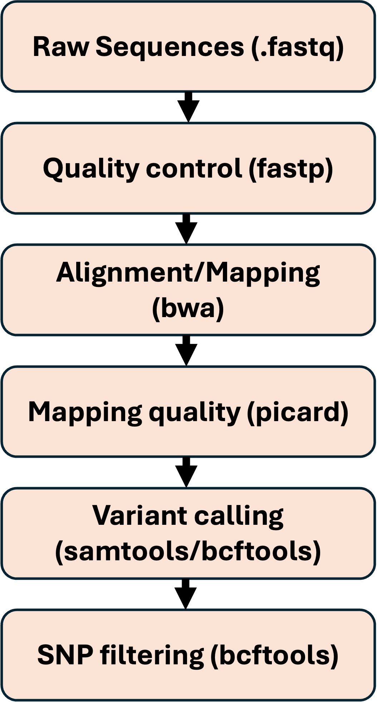

::: {.callout-note title="Learning objectives"}
By the end of this class you should be able to:

- Describe the main steps that take raw sequencing reads to a filtered VCF
- Read the header, fixed columns and genotype fields of a VCF
- Query a VCF with `bcftools` (header, samples, records and regions)
- Calculate per-individual missingness and depth with `vcftools`
- Write, submit and monitor a batch job on the VACC
:::

# What is a VCF?

A VCF (**V**ariant **C**all **F**ormat) file stores the positions in the genome where variants were found among our samples, along with every individual's genotype at those positions. It has two parts:

- a **header**: lines starting with `##` that record how the file was made and define every field used in it
- a **body**: one line per variant

The full specification is at <https://samtools.github.io/hts-specs/VCFv4.2.pdf>.

# How did we get our VCF?

We won't go through the entire pipeline from raw data to variants in this course, but it is worth knowing the basics. A typical pipeline is shown in @fig-pipeline.

{#fig-pipeline fig-align="center" width="264"}

::: callout-note
There are many different tools for each step of this pipeline, optimised for different data types and downstream analyses. The tools named here are the ones we used, not the only options!
:::

## From reads to alignments

1.  **Quality control and trimming.** Raw reads arrive from the sequencer as FASTQ files. We check read quality with FastQC (MultiQC combines many FastQC reports into one), then remove adapters and trim low-quality bases with a trimmer such as fastp (fastp also does the same as FastQC, but it is sometimes good to do both!).
2.  **Mapping.** The cleaned reads are mapped to the reference genome (or assembled *de novo* if there is no reference). We used BWA (the Burrows–Wheeler Aligner), which indexes the reference using the Burrows–Wheeler transform so it can work out where millions of short reads belong quickly and with little memory.
3.  **Cleaning up the alignments.** We then remove reads that would bias the variant calls, for example PCR duplicates (identical copies of the same DNA fragment made during library amplification) and reads that map poorly.

::: {.callout-note title="Mapping vs alignment"}
You will see many researchers use these terms interchangeably, as they are closely related. Strictly, **mapping** finds the *approximate* origin of a read (where in the genome did it come from?), while **alignment** works out the *exact* base-by-base differences between the read and the reference at that location.
:::

## Calling variants

Once the alignments are clean, we look for sites where the reads differ from the reference genome, i.e. single nucleotide polymorphisms (SNPs) and small insertions/deletions (indels). We used `bcftools mpileup`, which summarises the reads covering each position and calculates genotype likelihoods, followed by `bcftools call`, which decides which sites are variable and assigns each individual a genotype. The output of this step is our VCF.

## Filtering the VCF

Raw variant calls contain plenty of errors, so before we start any analyses we filter again. These are the filters we used:

| Filter | Threshold | Why |
|-------------------|-------------------|-----------------------------------|
| Variant type | Biallelic SNPs only | Indels and sites with more than two alleles are harder to call reliably, and many are sequencing errors |
| Site quality (`QUAL`) | ≥ 30 | A Phred score of 30 means a 1 in 1,000 chance that the call is wrong |
| Genotype depth | ≥ 3 reads | Genotypes supported by very few reads are unreliable, so they are set to missing |
| Missingness | Remove sites missing in \> 30% of individuals | Sites with lots of missing data add noise and can bias downstream analyses |
| Minor allele frequency (MAF) | Commonly 1% or 5% | Very rare alleles are hard to distinguish from sequencing errors; 5% is the stricter cut-off |

::: {.callout-note title="Phred scores"}
A Phred score converts an error probability *P* into *Q* = −10 log₁₀(*P*), so Q10 = 1 in 10, Q20 = 1 in 100 and Q30 = 1 in 1,000 chance of an error. You will meet Phred scores everywhere: base quality, mapping quality, variant quality and genotype quality.
:::

::: {.callout-note title="Coverage"}
The depth you can expect depends heavily on the species, sequencing method and budget. Low-coverage genomic sequencing (a few reads per site, often below about 6×) is now common for non-model species, whereas high coverage across whole genomes is mostly limited to humans and model organisms. At low coverage individual genotype calls are uncertain, which is why genotype-likelihood methods such as ANGSD exist.
:::

::: {.callout-warning title="MAF filters are not always appropriate"}
Rare alleles carry information about population history. Filtering on MAF is standard for analyses like PCA and ADMIXTURE, but analyses based on the site frequency spectrum (e.g. Tajima's *D*) need the rare alleles left in.
:::

# Looking inside a VCF

As with the transcriptomic data lets copy over the VCF's that I have already created for you.

``` bash

##Lets first create a new folder for our new module

### go to your ecol genomics folder something like: "~/projects/eco_genomics_2026/" and make your new directory
mkdir -p PopulationGenomics 

##copy the VCF files to your directory
cp /gpfs1/cl/biol3990/PopulationGenomics/VCF/*.vcf* /path/to/my/directory/PopulationGenomics

```

## A first look

VCFs are usually compressed with `bgzip` (hence `.vcf.gz`) because they are often very large. `zcat` decompresses the file and sends it to the screen, and `head` keeps only the first 20 lines:

``` bash
zcat Lottia_gigantea_biallelic.vcf.gz | head -n 20
```

You will mostly see a stream of `##contig` lines (long lines have been shortened with `...` here):

``` text
##fileformat=VCFv4.2
##FILTER=<ID=PASS,Description="All filters passed">
##bcftoolsVersion=1.16+htslib-1.16
##bcftoolsCommand=mpileup --threads 4 -Ou -f .../GCA_000327385.1_Helro1_genomic.fna
    --bam-list realigned.txt -q 5 -r KB201661.1,KB201662.1,...,KB201883.1
    -I -a FMT/AD,FMT/DP
##reference=file:///users/.../Lottiagigantea/ref/GCA_000327385.1_Helro1_genomic.fna
##contig=<ID=KB199650.1,length=9386848>
##contig=<ID=KB199651.1,length=4930979>
##contig=<ID=KB199652.1,length=1075990>
##contig=<ID=KB199653.1,length=1388>
##contig=<ID=KB199654.1,length=1389>
...
```

There is one `##contig` line for every sequence in the reference genome. Our reference, the owl limpet (*Lottia gigantea*) assembly, is scaffold-level: roughly 360 Mb split into thousands of scaffolds with no assembled chromosomes (4469 to be precise), so the header contains thousands of these lines.

::: {.callout-note title="Contigs, scaffolds and chromosomes"}
A **contig** is a continuous stretch of DNA sequence assembled from overlapping reads, with no gaps. Contigs are ordered and joined into **scaffolds** (which can contain gaps of unknown sequence, written as `N`s), and in the best assemblies scaffolds are placed onto **chromosomes**. How far an assembly gets depends on its quality. The VCF header calls every reference sequence a "contig", whichever of these it actually is.
:::

## Reading the header with bcftools

A better way to look at a VCF is with our first tool, `bcftools`. Load it on the VACC first, and always record which version you are using:

``` bash
module load gcc
module load bcftools

bcftools --version   # record the versions you use in your methods
bcftools -h          # -h or --help usually gets you the manual

bcftools head Lottia_gigantea_biallelic.vcf.gz
```

::: {.callout-note title="Accessing the manual"}
A quick note on finding the manual for software, sometimes `-h` wont work as it is some other function, but 99% of the time `--help` should get you the manual, otherwise Google the software! It is also worth noting that `-` is usually a shortened version of `--` e.g. `h` vs `help` but both do the same thing.
:::

Again we get a big string of contig lines. Let's pipe (`|`) the output into `grep` to remove them:

``` bash
bcftools head Lottia_gigantea_biallelic.vcf.gz | grep -v "##contig="
```

::: {.callout-note title="grep"}
`grep` ("**g**lobal **r**egular **e**xpression **p**rint") searches text for a pattern and prints the lines that match. The `-v` option inverts this, printing only the lines that *don't* match.
:::

Better. Now you can see how the file was made and what each field means. Each `##INFO` and `##FORMAT` line defines one of the tags used in the body of the file:

``` bash
bcftools view -h Lottia_gigantea_biallelic.vcf.gz | grep "^##INFO"
bcftools view -h Lottia_gigantea_biallelic.vcf.gz | grep "^##FORMAT"
```

`bcftools` also writes every command it runs into the header (in lines containing `Command=`), so you can often reconstruct how a file was made and filtered:

``` bash
bcftools view -h Lottia_gigantea_biallelic.vcf.gz | grep "Command="
```

## The VCF columns

The last line of the header names the columns of the body:

| Column | Contains |
|-------------------|-----------------------------------------------------|
| `#CHROM` | Chromosome (for us, scaffold) where the variants are found |
| `POS` | Position of the variant on that chromosome/scaffold |
| `ID` | Variant identifier; usually `.` (empty) unless you work on human genetics |
| `REF` | Reference allele |
| `ALT` | Alternative allele(s) |
| `QUAL` | Phred-scaled quality of the variant call |
| `FILTER` | `PASS` if the site passed all filters, otherwise the name of the filter it failed |
| `INFO` | Site-level information, e.g. total depth and allele counts; each tag is defined in a `##INFO` header line |
| `FORMAT` | The order of the individual-level fields that follow, e.g. `GT:PL:DP:AD:GQ` |

::: {.callout-tip title="Question"}
After `FORMAT` there is a long stream of names, e.g. `BOD08`, `BOD09`. What do you think these are?
:::

## Listing samples

The VCF also stores our sample names, which we can list with `bcftools query -l`:

``` bash
bcftools query -l Lottia_gigantea_biallelic.vcf.gz

# count the samples by piping into wc -l (counts lines)
bcftools query -l Lottia_gigantea_biallelic.vcf.gz | wc -l
```

::: {.callout-tip title="Question"}
What could you add to this command to find a specific group of samples, for example those from Bodega (`BOD`)?
:::

## Reading a variant record

Let's look at the first few SNPs to see what our data look like. The `-H` option drops the header so we only see variant records:

``` bash
# just the first record
bcftools view -H Lottia_gigantea_biallelic.vcf.gz | head -n 1

# the first 5 records; less -S stops long lines wrapping (press q to exit)
bcftools view -H Lottia_gigantea_biallelic.vcf.gz | head -n 5 | less -S

# -v selects variant types: here SNPs only
bcftools view -H -v snps Lottia_gigantea_biallelic.vcf.gz | head -n 5 | less -S

# what do you notice when we ask for indels?
bcftools view -H -v indels Lottia_gigantea_biallelic.vcf.gz | head -n 5 | less -S
```

::: {.callout-warning title="Always limit the output"}
Never run `bcftools view` on a whole VCF without piping it into `head` or `less`, or redirecting it to a file. Otherwise it will scroll millions of lines through your terminal (press `Ctrl + C` to stop it!).
:::

Your output will look something like this (in the file it is one tab-separated line; it is split over several lines here so it fits on the page):

``` text
KB201661.1  333  .  A  G  234.246  PASS
  DP=2684;VDB=0.041898;SGB=436.748;RPBZ=2.39793;MQBZ=0.160341;MQSBZ=0.0998937;
  BQBZ=0.949355;NMBZ=0.514698;SCBZ=-0.0592196;FS=0;MQ0F=0;AC=138;AN=588;
  DP4=600,944,217,323;MQ=59
  GT:PL:DP:AD:GQ
  0/1:0,9,107:3:3,0:127    ./.:0,6,97:2:2,0:127    ./.:0,0,0:0:0,0:0
  0/0:0,15,148:5:5,0:127   ./.:0,6,51:2:2,0:127    ./.:97,6,0:2:0,2:127
  0/0:0,84,255:28:28,0:127 ./.:0,0,0:0:0,0:0       ...
```

This is a SNP on scaffold `KB201661.1` at position 333, where the reference has an `A` and the alternative allele is a `G`. It passed all filters with a quality of 234. In the `INFO` column, `AC` (allele count) and `AN` (allele number) tell us that 138 of the 588 alleles called at this site are `G`, an allele frequency of 138/588 ≈ 0.23.

Each individual then has one entry, with its fields in the order given by `FORMAT`. For the first individual, `0/1:0,9,107:3:3,0:127` means:

| Field | Value | Meaning |
|-----------------|-----------------|---------------------------------------|
| `GT` | `0/0` | Genotype: `0/` = REF allele, `/0` = ALT allele, so `0/0` is homozygous for the reference (A/A) |
| `PL` | `0,9,107` | Phred-scaled likelihoods of the genotypes 0/0, 0/1 and 1/1; the most likely genotype is scaled to 0 and higher values are less likely |
| `DP` | `3` | Number of reads covering this site in this individual |
| `AD` | `3,0` | Allelic depth: 3 reads support the REF allele and 0 support the ALT allele |
| `GQ` | `127` | Genotype quality: Phred-scaled confidence in the `GT` call |

We filtered these VCFs to biallelic sites, so each site only ever has two possible alleles. In reality some sites are multiallelic, but these are often sequencing errors, and keeping only biallelic SNPs is standard practice. Genotypes are therefore written as `0/0`, `0/1`, `1/0` or `1/1`. The `/` means the genotype is unphased; phased genotypes use `|` which are only common for well annotated reference genomes that have little to no gaps.

::: {.callout-tip title="Question"}
How might we get the manual for the `view` command specifically?
:::

::: {.callout-tip title="Question"}
Some genotypes are `./.`. What might this mean? Look at the other fields for those individuals for a clue.
:::

::: {.callout-tip title="Question"}
To count the SNPs in a VCF we can pipe (`|`) our `bcftools` output into `wc -l`. How might we do that?
:::

## Viewing a region

Because the VCF is compressed with `bgzip`, `bcftools` can jump straight to a region of interest without reading the whole file, using the `-r` option with `chromosome:start-end`. This needs an index file (`.csi` or `.tbi`) next to the VCF; if there isn't one, `bcftools index` will make it, (I have already generated the index for you)

``` bash
ls Lottia_gigantea_biallelic.vcf.gz*   # is there a .csi or .tbi index?

# all SNPs between positions 8,000 and 9,000 on scaffold KB201661.1
bcftools view -H -r KB201661.1:8000-9000 Lottia_gigantea_biallelic.vcf.gz

# for a large region, pipe into head
bcftools view -H -r KB201661.1:8000-9000 Lottia_gigantea_biallelic.vcf.gz \
    | head -n 5
```

## Pulling out specific fields

`bcftools query -f` prints only the fields you ask for, which is how we will get data out of a VCF and into other programs. Fields are written as `%NAME`, `\t` is a tab, `\n` is a new line, and anything in square brackets is repeated for every sample:

``` bash
# scaffold, position, alleles and every individual's genotype for the first 5 SNPs
bcftools query -f '%CHROM\t%POS\t%REF\t%ALT[\t%GT]\n' \
    Lottia_gigantea_biallelic.vcf.gz | head -n 5
```

# Summary statistics with vcftools

Switching gears, let's get some basic statistics from our VCF using `vcftools`. To save time in class we will use a subset containing a random 1% of the variants, which you can also use for many of the downstream analyses yourself. The subset was made like this (you don't need to run it):

``` bash
bcftools view Lottia_gigantea_biallelic.vcf.gz \
    | vcfrandomsample -r 0.01 \
    | bgzip -c > Lottia_gigantea_biallelic_sub0.01.vcf.gz
```

Now calculate the proportion of missing data and the mean depth for each individual:

``` bash
module load vcftools

# proportion of missing genotypes per individual -> missing_data.imiss
vcftools --gzvcf Lottia_gigantea_biallelic_sub0.01.vcf.gz --missing-indv --out missing_data

# mean depth per individual -> depth_data.idepth
vcftools --gzvcf Lottia_gigantea_biallelic_sub0.01.vcf.gz --depth --out depth_data
```

In `missing_data.imiss`, the `F_MISS` column is the proportion of sites with a missing genotype for each individual; in `depth_data.idepth`, `MEAN_DEPTH` is each individual's average read depth. Individuals with lots of missing data or very low depth can distort the population structure analyses we will run next, so it is worth plotting these in R:

``` r
library(ggplot2)

imiss  <- read.delim("missing_data.imiss")
idepth <- read.delim("depth_data.idepth")

ggplot(imiss, aes(x = F_MISS)) +
  geom_histogram(bins = 30) +
  labs(x = "Proportion of missing genotypes", y = "Number of individuals")

ggplot(idepth, aes(x = MEAN_DEPTH)) +
  geom_histogram(bins = 30) +
  labs(x = "Mean depth", y = "Number of individuals")
```

# Your first batch job

OK, you have done it on a random subset... now let's do it on the real data with your first batch job! Jobs on the full VCF take much longer, so rather than overload your terminal we hand them to **Slurm**, the VACC's job scheduler, which runs them on a compute node when resources are free.

::: {.callout-note title="Slurm"}
Fun fact: the term slurm is a bacronymn from the futurama soda brand standing for: *Simple Linux Utility for Resource Management*. You will notice computer scientists often have an *interesting* sense of humour for naming things (see also Python and Git...)
:::

A batch script is a normal bash script with a header of `#SBATCH` lines telling Slurm what the job needs:

| Line | What it does |
|------------------------------|------------------------------------------|
| `#!/bin/bash` | Tells the system which language the script is written in |
| `#SBATCH --job-name=vcf_stats` | Name of your job; it appears in the queue and in your log file names |
| `#SBATCH --partition=general` | Which partition (group of nodes) on the VACC to use; we will always use `general` |
| `#SBATCH --nodes=1` | How many nodes to use; 1 is enough for almost everything in this course |
| `#SBATCH --cpus-per-task=1` | How many CPUs to use; only increase this for tools that can run multithreaded |
| `#SBATCH --mem=40G` | How much memory the job needs; this takes some trial and error. I would not go above 120G; beyond that, split the work up (e.g. by scaffold, with an array job) |
| `#SBATCH --time=30:00:00` | Time limit (hours:minutes:seconds); the job is stopped if it runs over |
| `#SBATCH --output=./logs/%x.%j.out` | Where anything the job would print to the terminal is saved; `%x` is the job name and `%j` the job ID |
| `#SBATCH --error=./logs/%x.%j.err` | Where error messages are saved; check here first if something goes wrong |
| `#SBATCH --mail-type=ALL` | Emails you when the job starts and finishes; use `END` to only hear when it finishes |
| `#SBATCH --mail-user=NETID@uvm.edu` | The email address to send these to (use your own!) |

Save the following as `vcf_stats.sh`:

``` bash
#!/bin/bash
#SBATCH --job-name=vcf_stats
#SBATCH --partition=general
#SBATCH --nodes=1
#SBATCH --cpus-per-task=1
#SBATCH --mem=40G
#SBATCH --time=30:00:00
#SBATCH --output=./logs/%x.%j.out
#SBATCH --error=./logs/%x.%j.err
#SBATCH --mail-type=ALL
#SBATCH --mail-user=NETID@uvm.edu

module load vcftools

vcftools --gzvcf Lottia_gigantea_biallelic.vcf.gz --missing-indv --out missing_data
vcftools --gzvcf Lottia_gigantea_biallelic.vcf.gz --depth --out depth_data
```

Then submit and keep an eye on it:

``` bash
sbatch vcf_stats.sh      # submit the job; Slurm replies with a job ID
squeue -u $USER          # check your jobs (PD = pending, R = running)
scancel <jobid>          # cancel a job if you need to
```

After it has run if you did `#SBATCH --mail-type=ALL` you should get an email stating it is done, you should check that your outfiles now exist and also check your log files within the folder "log" named as `.out` and `.err`

# Exercises

1.  What version of `bcftools` is on the VACC?
2.  Why is the tool called `bcftools` and not `vcftools`? (Hint: what is a BCF file?)
3.  How might you look at the end of the VCF to make sure the file is complete and has no errors?
4.  We often call SNPs chromosome by chromosome (or scaffold by scaffold) and end up with lots of VCFs. Can you find the `bcftools` command you would use to join them back together?
5.  Plot the missingness and depth results from your batch job in R. Are there any individuals you would consider removing before next class's population structure analyses?
6. If a population has loci that are 100% 0/0 or 1/1 what does this mean for that loci?


Thats all for our VCF intro! Next class we will dive into the genomic structure of our populations using tools like `ADMIXTURE` and `PCA` (which you are familiar with through transcriptomics)
